# Virasya — Platform Architecture & Technical Design

**Document:** Canonical Architecture Overview  
**Path:** [`Documentations/ARCHITECTURE.md`](file:///D:/Codes/gnani.ai/Documentations/ARCHITECTURE.md)  
**Target Environments:** Vercel (Frontend), Supabase Cloud (Backend/DB), Python CLI & Studio (Local)

---

## 1. High-Level Architectural Topology

```mermaid
flowchart TD
    subgraph Client["Presentation Tier (Client / Browser)"]
        UI["React 19 SPA (Vite + TailwindCSS)"]
        Hero["Three.js 3D Manuscript Hero"]
        Map["36-Region SVG India Map"]
        Flow["6-Step Preservation Workflow"]
        UI --- Hero
        UI --- Map
        UI --- Flow
    end

    subgraph ProductionBackend["Serverless Backend Tier (Supabase Cloud)"]
        Auth["Supabase Auth (Magic Link + PKCE)"]
        Storage["Private Storage Bucket (story-recordings-private, 5 MiB)"]
        Postgres["PostgreSQL Database (RLS Hardened)"]
        EdgeTranscribe["Edge Function: transcribe-audio"]
        EdgePreserve["Edge Function: preserve-story"]
        EdgeAudio["Edge Function: get-story-audio"]
    end

    subgraph ExternalProvider["Third-Party AI Service"]
        Gnani["Gnani.ai Prisma STT v3 REST API (https://api.vachana.ai/stt/v3)"]
    end

    subgraph LocalWorkbench["Local Python Workbench (Optional / Offline)"]
        CLI["Python CLI (virasya)"]
        PyServer["Studio Server (ThreadingHTTPServer: 5000)"]
        DiskStore["Local JSON Store (data/output/)"]
        CLI --- PyServer
        PyServer --- DiskStore
    end

    %% Client Interactions
    UI -->|JWT Auth / Sign-in| Auth
    UI -->|Direct Upload to user folder| Storage
    UI -->|Query explore_stories view| Postgres
    UI -->|POST multipart audio| EdgeTranscribe
    UI -->|POST preservation sealing| EdgePreserve
    UI -->|GET signed playback URL| EdgeAudio

    %% Serverless Interactions
    EdgeTranscribe -->|Enforce atomic quota lock| Postgres
    EdgeTranscribe -->|Download recording for verification| Storage
    EdgeTranscribe -->|Proxy multipart request with X-API-Key-ID| Gnani
    EdgePreserve -->|Verify audio duration & seal story| Postgres
    EdgeAudio -->|Verify playback consent & sign URL| Storage

    %% Local Interactions
    CLI -->|Direct POST| Gnani
    PyServer -->|Direct POST| Gnani
```



---

## 2. Repository Structure & Module Responsibilities

```text
D:\Codes\gnani.ai/
├── README.md                     # Root landing hub & quickstart
├── .env.example                  # Master environment variable template
├── Documentations/               # Canonical Platform Documentation
│   ├── PRD.md                    # Product requirements, personas & scope
│   ├── ARCHITECTURE.md           # System topology, sequence flows & RLS
│   ├── API_REFERENCE.md          # Full endpoint catalog (CLI, Studio, Edge)
│   └── CONTRIBUTING.md           # Dev setup, testing workflows & security
│
├── frontend/                     # Production React 19 Frontend (Vercel)
│   ├── src/
│   │   ├── app/App.tsx           # SPA root, routing & global modal mounts
│   │   ├── auth/                 # Passwordless magic-link context & modal UI
│   │   ├── explore/              # Public archive feed & cultural glossary drawer
│   │   ├── preserve/             # 6-step oral narrative preservation cockpit
│   │   ├── sections/             # Lander sections (Hero, IndiaMap, Trust, FAQ)
│   │   ├── supabase/             # Client SDK singleton, adapters & queries
│   │   └── three/                # Three.js 3D animated manuscript canvas
│   ├── tests/                    # 17 automated test suites (Jest/Node CJS)
│   ├── vercel.json               # SPA rewrites & production HTTP security headers
│   └── package.json              # React 19, Vite 8, TailwindCSS 4, Three.js
│
├── supabase/                     # Canonical Serverless Backend
│   ├── functions/                # Deno / TypeScript Edge Functions
│   │   ├── transcribe-audio/     # ASR proxy with atomic rate-limiting & fail-closed quota
│   │   ├── preserve-story/       # Atomic SHA-256 story sealing & duration validation
│   │   └── get-story-audio/      # Consent-gated authorized playback tickets
│   └── migrations/               # Canonical PostgreSQL Schema & RLS Migrations
│       ├── 20261017000000_...sql # Base tables (profiles, stories, vocabulary, RLS)
│       ├── 20261023000000_...sql # Concurrency-safe story sealing & provenance
│       ├── 20261024000000_...sql # Immutability trigger, explore_stories view, quota RPC
│       └── 20261024010000_...sql # Storage bucket 5 MiB file size limit reconciliation
│
└── virasya-ai/                   # Python Workbench & Scriptable CLI
    ├── src/virasya_ai/
    │   ├── cli.py                # Command-line entry point (virasya)
    │   ├── config.py             # Environment configuration (.env loader)
    │   ├── exceptions.py         # Standardized error hierarchy
    │   ├── transcription/        # Gnani API client & audio ingestion decoding
    │   └── web/
    │       ├── server.py         # Standard library ThreadingHTTPServer (virasya-web)
    │       └── static/           # Static browser review workspace
    ├── tests/                    # 73 pytest unit & integration tests
    └── pyproject.toml            # Python packaging metadata & entry points
```

---

## 3. Data Flow Pipelines

### 3.1 Speech-to-Text Transcription Flow
```mermaid
sequenceDiagram
    autonumber
    actor User as Storyteller / Client
    participant Frontend as React Frontend
    participant Edge as Edge Function (transcribe-audio)
    participant DB as Supabase PostgreSQL
    participant Storage as Supabase Storage
    participant Gnani as Gnani Prisma STT API

    User->>Frontend: Records spoken audio (max 60s)
    Frontend->>Storage: Direct upload to story-recordings-private/{user_id}/{filename}
    Frontend->>Edge: POST /functions/v1/transcribe-audio (storage_path, language, format)
    Note over Edge: Validates JWT & author ownership
    Edge->>DB: RPC check_and_consume_transcription_quota(user_id)
    Note over DB: Serializes request via pg_advisory_xact_lock
    DB-->>Edge: Returns { allowed: true/false, current_count }
    alt Quota Exceeded or Error
        Edge-->>Frontend: HTTP 429 / 500 (Fail-closed; halts immediately)
    else Quota Permitted
        Edge->>Storage: Downloads recording for server-side verification
        Note over Edge: Validates container header, size <= 5 MiB, duration <= 60.0s
        Edge->>Gnani: Outbound POST multipart/form-data with X-API-Key-ID
        Gnani-->>Edge: Returns raw transcript JSON
        Edge-->>Frontend: Returns standardized TranscribeResponse
    end
    Frontend->>User: Displays editable verbatim transcript in Step 3 (Review)
```

### 3.2 Story Preservation & Archival Sealing Flow
1. **Editorial Review:** The archivist corrects phonetic mistranscriptions, adds dialect terms to the Cultural Vocabulary glossary, and approves the text.
2. **Provenance Generation:** The client invokes `preserve-story` Edge Function.
3. **Cryptographic Sealing:** 
   - Backend calculates a SHA-256 hash over narrative text, audio filename, language, and timestamp.
   - Assigns provenance ID: `VIR-{hash[:12]}`.
   - Calls atomic PostgreSQL function `seal_story_preservation` using `SELECT ... FOR UPDATE` to prevent concurrent TOCTOU race conditions.
4. **Trigger Immutability:** Once `status = 'preserved'`, PostgreSQL trigger `enforce_preserved_story_immutability()` prevents standard clients from editing narrative text, audio, vocabulary, or demoting status to `'draft'` (`SQLSTATE 23514`).

---

## 4. Security & Isolation Architecture

1. **Defense-in-Depth Authorization:** Database functions enforce `is_trusted_backend()`. Ordinary authenticated JWTs cannot invoke administrative RPCs or delete preserved assets.
2. **Explore Data Minimization:** Anonymous visitors query `public.explore_stories WITH (security_barrier = true)`. Personal email addresses, internal user IDs, and raw storage paths are scrubbed at the database engine level.
3. **Audio Playback Privacy:** Audio signed URLs are issued only when `status = 'preserved' AND visibility = 'public' AND audio_public_playback = true`, or when requested by the authentic story owner.
4. **Browser Security Headers:** `vercel.json` applies Strict-Transport-Security (HSTS), X-Content-Type-Options (`nosniff`), frame-ancestors (`none`), and Permissions-Policy (`microphone=(self)`).
