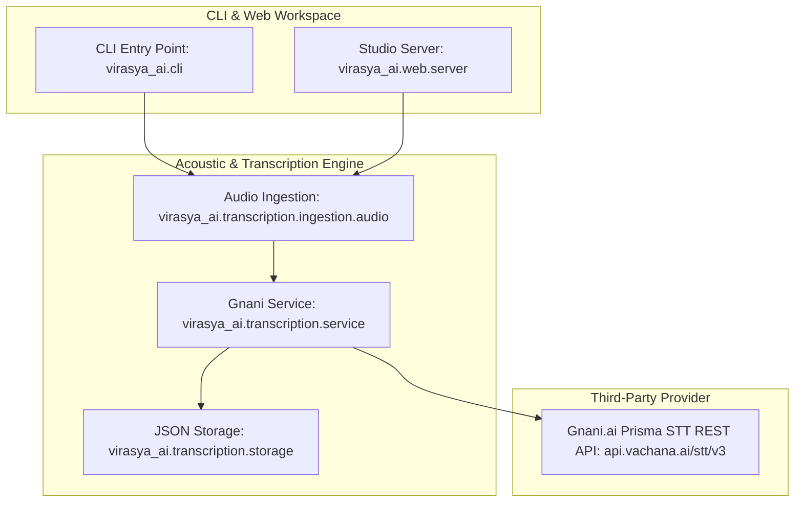

# Architecture Overview — Virasya AI Subproject

> [!NOTE]
> **Canonical Platform Architecture:** For full cross-tier platform architecture, sequence diagrams, and cloud topologies, see [**`ARCHITECTURE.md`**](../Documentations/ARCHITECTURE.md).

---

## Python Subproject Architecture (`virasya-ai`)

### Module Responsibilities
* **`virasya_ai.cli`:** Positional `audio_path` and optional `-o/--output` parsing, exit code mapping, and stdout / file writing.
* **`virasya_ai.web.server`:** Python standard library `ThreadingHTTPServer` handling 18 REST endpoints for local preview and development.
* **`virasya_ai.transcription.ingestion.audio`:** Format allowlisting, file size enforcement (≤ 5 MiB), and duration checks (≤ 60s) via `soundfile` with `ffmpeg` subprocess fallback.
* **`virasya_ai.transcription.service`:** Outbound HTTP client (`requests`) targeting Gnani Prisma STT v2.5 with `X-API-Key-ID` header.
* **`virasya_ai.transcription.storage`:** Atomic JSON persistence appending to `data/output/transcriptions.json`.
* **`virasya_ai.config`:** Environment variable loading from `.env` and defaults.
* **Authentication Boundary:** Downstream resource server validating Supabase JWT Bearer tokens via `GET /auth/v1/user` when `VIRASYA_REQUIRE_AUTH=true`. See [`SUPABASE_AUTH_INTEGRATION.md`](../frontend/docs/SUPABASE_AUTH_INTEGRATION.md).

For public HTTP and CLI interfaces, see the canonical [**`API_REFERENCE.md`**](../Documentations/API_REFERENCE.md).
